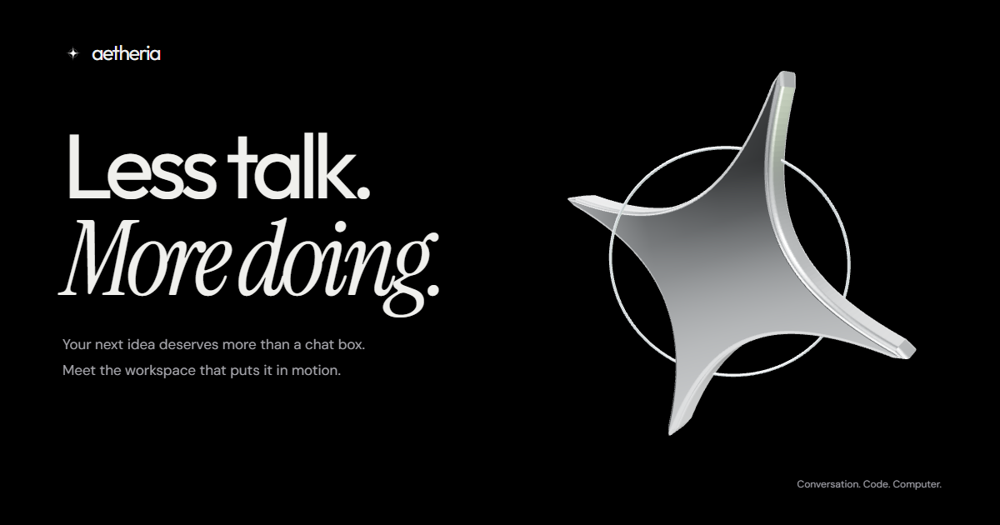

# Aetheria AI — Web Platform & Operating System Portal

<div align="center">



**The Autonomous AI Operating System**  
*Your computer has a new operator. Aetheria connects your tools, runs agent workflows, and turns ideas into finished work.*

[](https://nextjs.org/)
[](https://react.js.org/)
[](https://www.typescriptlang.org/)
[](https://tailwindcss.com/)
[](https://threejs.org/)
[](https://supabase.com/)
[](https://www.convex.dev/)

[Live Site](https://aetheriaai.online) • [Releases](https://github.com/GodBoii/AI-OS-website/releases) • [Product Playbook](https://aetheriaai.online/playbook) • [Documentation](https://aetheriaai.online/changelog)

</div>

---

## 📖 Overview

**Aetheria AI** is an advanced cross-platform agentic AI assistant designed to operate across desktop and mobile operating systems (Windows, Linux, macOS, and Android). Unlike traditional conversational chatbots, Aetheria functions as an autonomous system operator—coordinating multi-agent workflows, integrating developer and productivity tools, managing memory, and executing complex tasks locally and in the cloud.

This repository (`AI-OS-website`) hosts the **official public marketing platform, interactive playground, release distribution center, and authenticated account usage portal** for Aetheria AI.

---

## ✨ Key Features

### 1. 🌟 Interactive Experience & Product Showcase
- **Three.js 3D Star Sculpture (`StarSculpture.tsx`)**: Real-time rendering of Aetheria's brand mark with mouse tilt, 3D inertia dragging, keyboard rotation controls, and graceful SVG fallback for systems without WebGL or on GPU context loss.
- **Workflow Execution Playground**: Hands-on simulated playground letting visitors inspect and test real agentic tasks:
  - *Build a page*: Generates responsive, self-contained HTML documents.
  - *Make a brief*: Synthesizes project updates into categorized decisions and action items.
  - *Clean a sheet*: Normalizes contact tables and strips duplicate entries with instant CSV export.
- **GSAP & Lenis Smooth Motion**: Smooth scroll orchestrations, pinned manifesto sections, and full WCAG reduced-motion preference compliance.
- **Contextual Wayfinder Companion**: In-app guide offering audio tours (via browser Web Speech API), proactive walkthrough tips, and dismissible hints.

### 2. 🔐 Authentication & Account Management
- **Supabase Authentication**: Integrated Email/Password authentication and Google OAuth using PKCE flows (`/auth/login`, `/auth/signup`, `/auth/callback`).
- **Profile Synchronization**: Automatic profile creation and metadata synchronization via Supabase PostgreSQL triggers (`public.profiles`).
- **Route Protection**: Next.js middleware and client session checks guarding the user dashboard.

### 3. 📊 Real-Time Token Usage Dashboard (`/dashboard`)
- **Convex Database Engine**: Backed by a high-performance Convex real-time backend (`convex/schema.ts`) recording token usage events (`usage_events`) and daily aggregates (`usage_daily`).
- **Dynamic Chart.js Visualizations (`UsageCard.tsx`)**:
  - Interactive Daily Token Consumption chart with smooth bar/line toggles.
  - Timeframe filtering: **7 Days**, **30 Days**, **90 Days**, or **All Time**.
  - Detailed daily ledger table displaying input, output, and total token breakdowns.
  - Tier quota tracking against plan limits (Core, Pro, Elite).

### 4. 🚀 Cross-Platform Client Distribution (`/download`)
- Direct access to native desktop and mobile installers hosted on GitHub Releases:
  - **Windows**: `.exe` Installer (Windows 10 & 11, 64-bit)
  - **Linux**: `.AppImage` standalone desktop binary
  - **Android**: `.apk` mobile client package
- Automated GitHub API release ingestion with dynamic changelog notes (`/changelog`).

### 5. 💼 Startup Strategy & Investor Portal
- **Interactive Playbook (`/playbook`)**: Expandable 6-month product roadmap, market landscape, and competitive analyses.
- **Investor Relations (`/investor`)**: Transparent burn rate models, multi-scenario MRR projections, and founder contact channels.
- **Transparent Tier Pricing (`/pricing`)**: Clear breakdown of Core (Free), Pro, and Elite tiers with token budgets.

---

## 🛠️ Architecture & Tech Stack

| Layer | Technologies |
|---|---|
| **Framework** | [Next.js 14.1](https://nextjs.org/) (Pages Router), [React 18.2](https://react.dev/), [TypeScript 5.3](https://www.typescriptlang.org/) |
| **Styling** | [Tailwind CSS 3.4](https://tailwindcss.com/), Custom Design System (`globals.css`, `experience.css`, `studio.css`) |
| **3D & Animation** | [Three.js](https://threejs.org/), [GSAP](https://greensock.com/gsap/) (`@gsap/react`), [Framer Motion](https://www.framer.com/motion/), [Lenis](https://lenis.darkroom.engineering/) |
| **Icons & Media** | [Lucide React](https://lucide.dev/), [React Icons](https://react-icons.github.io/react-icons/) |
| **Charts** | [Chart.js 4.4](https://www.chartjs.org/), [react-chartjs-2](https://react-chartjs-2.js.org/) |
| **Auth & Profiles** | [Supabase](https://supabase.com/) (`@supabase/ssr`, `@supabase/supabase-js`, `@supabase/auth-helpers-nextjs`) |
| **Realtime Usage DB** | [Convex](https://www.convex.dev/) (Event aggregation, rate limiting, and analytics) |
| **Hosting & CI/CD** | [Vercel](https://vercel.com/) |

---

## 📁 Project Structure

```text
AI-OS-website/
├── api/                         # Standalone API helpers
├── components/                  # React UI components
│   ├── experience/              # 3D sculpture, motion director, companion guide
│   │   ├── Companion.tsx        # Audio & contextual wayfinder guide
│   │   ├── ComparisonScene.tsx  # Competitor comparison matrix
│   │   ├── MotionDirector.tsx   # GSAP scroll coordinator
│   │   ├── StarSculpture.tsx    # Three.js 3D brand sculpture
│   │   └── WorkspaceTheatre.tsx # Interactive workflow simulator
│   ├── homepage/                # Landing page scenes (Hero, Execution, Header, Footer)
│   ├── AccountForm.tsx          # Unified auth entry form (Login & Signup)
│   ├── AuthFrame.tsx            # Auth layout wrapper
│   ├── DetailedPlaybook.tsx     # Expandable product roadmap & financials
│   ├── ForYouSection.tsx        # Workflow use cases & integrations
│   ├── Layout.tsx               # Global layout wrapper (Header, Footer, Lenis)
│   ├── SEO.tsx                  # Meta tags, OpenGraph, JSON-LD schemas
│   └── UsageCard.tsx            # Chart.js token analytics & daily ledger
├── convex/                      # Convex backend schema & query definitions
│   ├── _generated/              # Auto-generated Convex client code
│   ├── schema.ts                # Database tables: usage_events, usage_daily, etc.
│   └── usage.ts                 # Aggregation & query endpoints
├── lib/                         # Client utilities & shared logic
│   ├── downloads.ts             # Installer release metadata & targets
│   ├── experience.ts            # Simulation workflow data & actions
│   ├── showcase.ts              # Product showcase specifications
│   ├── supabaseClient.ts        # Supabase client instantiation & helpers
│   └── utils.ts                 # Classname merge helpers (clsx & tw-merge)
├── pages/                       # Next.js Pages Router
│   ├── api/                     # Backend API routes
│   │   ├── convex-test.ts       # Health check for Convex deployment
│   │   ├── convex-usage.ts      # Aggregated usage query endpoint
│   │   ├── log-usage.ts         # Token consumption ingestion
│   │   ├── profile.ts           # Supabase user profile query
│   │   └── usage.ts             # Backward-compatible usage proxy
│   ├── auth/                    # Auth routes: /login, /signup, /callback
│   ├── 404.tsx                  # Custom branded 404 error page
│   ├── _app.tsx                 # App root with fonts, theme, & global styles
│   ├── _document.tsx            # Custom HTML document definition
│   ├── changelog.tsx            # Dynamic release history from GitHub API
│   ├── dashboard.tsx            # Authenticated analytics & download portal
│   ├── download.tsx             # Public native client download page
│   ├── for-you.tsx              # Deep-dive use cases & integrations
│   ├── index.tsx                # Main product landing page
│   ├── investor.tsx             # Investor pitch, metrics, & financial model
│   ├── playbook.tsx             # Product strategy, milestones, & deck
│   ├── pricing.tsx              # Plan comparison (Core, Pro, Elite)
│   ├── privacy-policy.tsx       # Privacy policy
│   └── terms.tsx                # Terms of service
├── public/                      # Static assets, branding, and images
├── styles/                      # Global and component styles
│   ├── experience.css           # 3D, animations, & playground aesthetics
│   ├── globals.css              # Core tokens, Tailwind base, resets
│   └── studio.css               # Marketing components & typography
├── middleware.ts                # Next.js Supabase session middleware
├── next.config.js               # Next.js configuration
├── tailwind.config.js           # Tailwind CSS configuration
└── tsconfig.json                # TypeScript compiler configuration
```

---

## 🚦 Getting Started

### Prerequisites

Ensure you have the following installed:
- **Node.js**: `v18.17.0` or higher (Node 20 recommended)
- **npm**: `v9.0.0` or higher
- **Git**

### 1. Clone the Repository

```bash
git clone https://github.com/GodBoii/AI-OS-website.git
cd AI-OS-website
```

### 2. Install Dependencies

```bash
npm install
```

### 3. Configure Environment Variables

Create a `.env.local` file in the root directory:

```bash
cp .env.example .env.local  # or create manually
```

Populate the required keys:

```ini
# Supabase Configuration
NEXT_PUBLIC_SUPABASE_URL=https://your-project.supabase.co
NEXT_PUBLIC_SUPABASE_ANON_KEY=your-anon-key
SUPABASE_SERVICE_ROLE_KEY=your-service-role-key

# Convex Database Configuration
CONVEX_URL=https://your-deployment.convex.cloud
CONVEX_ADMIN_KEY=your-convex-admin-key
```

### 4. Run the Development Server

```bash
npm run dev
```

Open [http://localhost:3000](http://localhost:3000) in your browser.

---

## 📜 Available Scripts

| Command | Action |
|---|---|
| `npm run dev` | Starts the Next.js local development server (with HMR) |
| `npm run build` | Compiles and optimizes production assets, prerendering static pages |
| `npm run start` | Boots the compiled production server |
| `npm run lint` | Runs ESLint checks across the codebase |

### Isolated Production Review Build

To test a production build on an isolated port without interfering with `.next` dev caches:

```powershell
# Windows PowerShell
$env:AETHERIA_REVIEW = '1'
npm.cmd run build
node node_modules/next/dist/bin/next start -p 3012
```

This builds into `.next-review` and serves at [http://localhost:3012](http://localhost:3012).

---

## 🗄️ Database & Backend Services

### Supabase Setup
- **User Profiles**: Stored in `public.profiles`, linked to `auth.users(id)`.
- **Database Trigger**: Runs `public.create_profile_for_user()` upon user signup to automatically initialize profile records.
- **Reference Schema**: See [database-schema.sql](database-schema.sql) and [supabase.md](supabase.md).

### Convex Real-Time Analytics
- **`usage_events`**: Stores atomic token usage logs containing `user_id`, `input_tokens`, `output_tokens`, `total_tokens`, and timestamps.
- **`usage_daily`**: Aggregates token usage per calendar day for lightning-fast chart rendering.
- For in-depth architecture details, consult [CONVEX_USAGE_ANALYSIS.md](CONVEX_USAGE_ANALYSIS.md).

---

## 🚢 Deployment

The website is optimized for deployment on **Vercel**:

1. Import the repository in [Vercel Dashboard](https://vercel.com/dashboard).
2. Add all environment variables from your `.env.local` to **Settings → Environment Variables** (for Production, Preview, and Development).
3. Ensure Supabase Auth redirect URLs include:
   - `https://your-domain.com/`
   - `https://your-domain.com/auth/callback`
4. Deploy! Vercel will automatically build and distribute the app across its global Edge Network.
5. Post-deployment verification:
   - Check API health: `https://your-domain.com/api/convex-test` (should respond `{ "ok": true }`)
   - Check authenticated analytics: `https://your-domain.com/dashboard`

---

## 🤝 Contributing

Contributions, feedback, and issue reports are welcome!

1. Fork the repository
2. Create your feature branch (`git checkout -b feature/amazing-feature`)
3. Commit your changes (`git commit -m 'feat: add amazing feature'`)
4. Push to the branch (`git push origin feature/amazing-feature`)
5. Open a Pull Request

---

## 📄 License & Contact

- **Inquiries & Support**: [aetheria.ai28@gmail.com](mailto:aetheria.ai28@gmail.com)
- **Website**: [aetheriaai.online](https://aetheriaai.online)
- **Repository**: [GodBoii/AI-OS-website](https://github.com/GodBoii/AI-OS-website)
